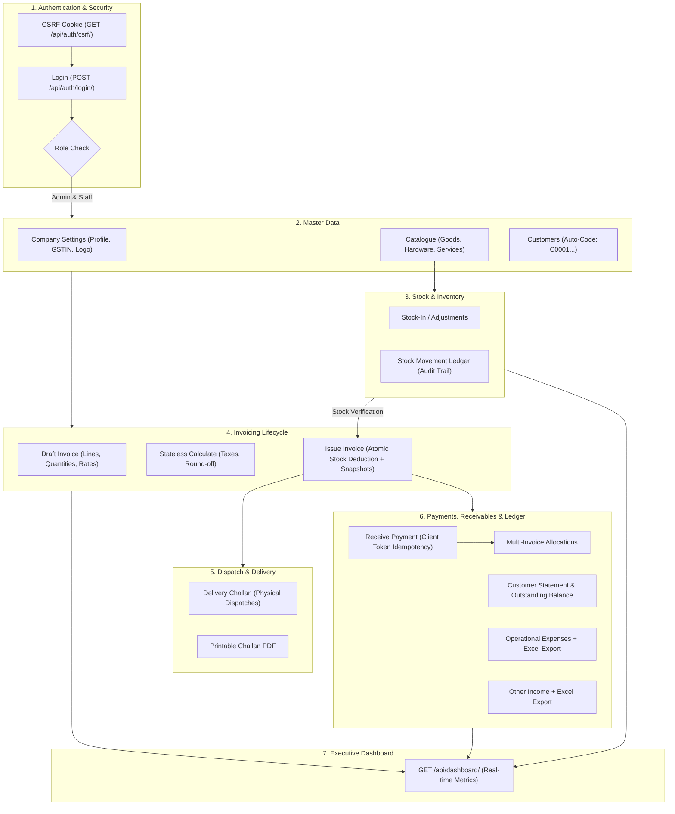

# Billing & Inventory Management System (V1)
## Complete System Flow, Architecture & API Specification

---

## 1. System Overview & Technology Stack

This system is an **inventory-first, multi-role billing, dispatch, and accounting platform** designed for businesses operating under Indian commercial tax regulations (GST / Non-GST).

### Core Stack
- **Framework:** Django 4.2 + Django REST Framework (DRF) 3.17
- **Database:** PostgreSQL (Database name: `billing_inventory`, port `5432`)
- **Authentication:** Cookie-based session authentication with CSRF tokens (`sessionid` + `csrftoken`), strictly forbidding token storage in `localStorage`.
- **Document Generation:** `xhtml2pdf` / ReportLab for pixel-perfect PDF rendering (Tax Invoices and Delivery Challans).
- **Data Export:** `openpyxl` for high-fidelity Excel (.xlsx) financial workbooks.
- **API Documentation:** `drf-spectacular` (OpenAPI 3.0 schema and Swagger/Redoc).

---

## 2. Database & Data Persistence

### Real Database vs Dummy Data
- **Real Database:** The system connects directly to a real, live PostgreSQL instance (`billing_inventory`).
- **Pragmatic Schema:** 27 managed relational tables with foreign keys, check constraints, unique constraints, and database indexes.
- **Zero Dummy Data:** The live database holds real data. Automated tests execute inside an isolated ephemeral test database (`test_billing_inventory`), ensuring that testing runs never pollute the live production database.
- **Seeding Utilities:** 
  - Units and categories (Expenses, Income) are pre-seeded or managed through the admin.
  - A command (`python manage.py seed_demo_data`) is available solely for optional development and UI prototyping.

---

## 3. High-Level System Architecture & Flow



---

## 4. Detailed App-by-App Breakdown

### 4.1. `apps.accounts` — User Identity & Role-Based Access Control
- **Purpose:** Secure user sessions, authentication, and staff account management.
- **User Roles:**
  - `ADMIN`: Business owner; full access to settings, staff creation, password overrides, and reporting.
  - `STAFF`: Operational personnel; creates invoices, customers, products, payments, challans, expenses, but cannot alter system configuration or delete core records.
- **Key Features:**
  - **Session Auth:** Cookie-based (`HttpOnly`, `SameSite=Lax`).
  - **CSRF Protection:** Handshake via `/api/auth/csrf/`.
  - **Brute Force Protection:** Strict rate limit of 5 login attempts per minute per IP + username combination.
  - **Session Invalidation:** Deactivating a staff member immediately terminates all their active sessions.

### 4.2. `apps.company` — Business Profile & Document Customization
- **Purpose:** Stores the single-row company entity (`id=1`) used for branding invoices, receipts, and challans.
- **Fields:** Business name, physical address, phone, email, GSTIN, and company logo.
- **Behavior:**
  - Auto-initializes on startup if no record exists.
  - Only `ADMIN` can update business settings.

### 4.3. `apps.customers` — Customer Relationship Management
- **Purpose:** Manages clients and receivables tracking.
- **Sequential Collision-Safe Code Generation:**
  - Uses `CustomerCodeCounter` locked with `SELECT FOR UPDATE` inside an atomic transaction.
  - Codes follow the pattern `C0001`, `C0002`, etc., and are strictly read-only after creation.
- **GST Validation:** Validates Indian state choices against official GST state codes.

### 4.4. `apps.products` — Catalogue & Product Definitions
- **Item Types:**
  - `GOODS`: Standard manufactured/purchased inventory (tracks stock).
  - `GOODS_HARDWARE`: Physical hardware inventory (tracks stock).
  - `SERVICE`: Labor, consultation, or work charges (never tracks stock; opening stock and reorder levels are rejected).
- **Sequential Product Codes:** Auto-generates sequential codes (`P0001`, `P0002`, ...) using an atomic counter.
- **Stock Tracking & Alerts:** Computes low stock status dynamically when `current_stock <= reorder_level`.

### 4.5. `apps.inventory` — Stock Movement Ledger
- **Purpose:** Append-only ledger recording every single physical inventory change.
- **Movement Types:** `OPENING_STOCK`, `STOCK_IN`, `STOCK_OUT`, `ADJUSTMENT`.
- **Integrity Rule:** `current_stock` on `Product` must exactly match the cumulative sum of historical `StockMovement` entries for that product.
- **Command:** `python manage.py check_stock_consistency` runs automated audits.

### 4.6. `apps.invoices` — Invoicing Engine
- **Lifecycle:**
  1. **Draft (`DRAFT`):** Fully editable. Items can be added, updated, or removed. No stock is deducted. Watermarked as "DRAFT" when rendered as PDF.
  2. **Stateless Calculation (`/api/invoices/calculate/`):** Preview taxes, CGST, SGST, round-off, and grand total in real time without writing to the database.
  3. **Issuance (`POST /api/invoices/{id}/issue/`):**
     - Atomically checks stock availability for all tracked goods on the invoice.
     - Decrements product stock in a single transaction.
     - Writes `STOCK_OUT` entries to the inventory ledger.
     - Takes an **immutable historical snapshot** of customer details, product names, codes, units, and company profile.
     - Locks the invoice: issued invoices can **never** be edited or deleted.
- **Tax Calculation Engine:**
  - Detects GST eligibility based on customer GSTIN.
  - Splits GST rate equally into `CGST` and `SGST` (for intra-state trade).
  - Calculates line total, taxable amount, tax amounts, and mathematical round-off to the nearest whole rupee.
- **PDF Generation:** Produces official tax invoices formatted for standard A4 printing, converting numerical grand totals to Indian Rupee word representations (Lakhs / Crores).

### 4.7. `apps.delivery` — Delivery Challans (Dispatch Documents)
- **Purpose:** Accompanies goods physically dispatched from the warehouse against issued invoices.
- **Rules:**
  - Multiple partial challans can be issued against one invoice.
  - Prevents dispatching more quantity than what was ordered on the invoice line.
  - Does not change stock; stock was already deducted at invoice issuance.
  - Implements document generation for printing physical delivery slips with receiver signature blocks.

### 4.8. `apps.payments` — Customer Payments & Receivables Settlement
- **Purpose:** Records payments received from customers and distributes them across one or more open invoices.
- **Multi-Invoice Allocation:**
  - One payment of ₹10,000 can settle ₹6,000 on Invoice #101 and ₹4,000 on Invoice #102.
  - Total allocation amounts must strictly equal the payment amount.
- **Idempotency:** Accepts an optional `client_token` (UUID) from the frontend so network retries never record duplicate payments.
- **Customer Statement:** Computes real-time running balances, total invoiced, total paid, and total outstanding receivables.

### 4.9. `apps.expenses` — Operational Expenses
- **Purpose:** Logs day-to-day business costs (Rent, Electricity, Fuel, Salaries, Maintenance).
- **Categories:** Pre-seeded categories with custom category creation support.
- **Excel Export:** Generates formatted `.xlsx` workbooks for any date range with column formulas, title blocks, and totals.

### 4.10. `apps.other_income` — Miscellaneous Revenue
- **Purpose:** Logs secondary business income outside the invoice flow (Scrap sales, Interest, Commissions).
- **Excel Export:** Dedicated date-filtered `.xlsx` export.

### 4.11. `apps.dashboard` — Executive Analytics
- **Purpose:** A single, consolidated endpoint (`GET /api/dashboard/`) delivering key performance indicators:
  - Today's sales (issued invoices today).
  - Month's total sales and invoice count.
  - Payments received this month.
  - Total outstanding customer receivables.
  - Active stock counts and list of products at or below reorder level.
  - Monthly expenses vs other income totals.
  - 5 most recent issued invoices.

---

## 5. API Reference Sheet for Frontend Developers

### Authentication & Staff
| Method | Endpoint | Access | Description |
|---|---|---|---|
| `GET` | `/api/auth/csrf/` | Public | Obtains CSRF cookie |
| `POST` | `/api/auth/login/` | Public | Signs in (`username`, `password`) |
| `POST` | `/api/auth/logout/` | Authenticated | Signs out and terminates session |
| `GET` | `/api/auth/me/` | Authenticated | Gets active user profile |
| `GET` | `/api/staff/` | Admin | Lists staff members |
| `POST` | `/api/staff/` | Admin | Creates new staff member |
| `GET` | `/api/staff/{id}/` | Admin | Staff member details |
| `PATCH` | `/api/staff/{id}/` | Admin | Updates staff (activate/deactivate) |
| `POST` | `/api/staff/{id}/set-password/` | Admin | Resets staff password |

### Company Settings
| Method | Endpoint | Access | Description |
|---|---|---|---|
| `GET` | `/api/company/` | Authenticated | Retrieves company profile |
| `PATCH`| `/api/company/` | Admin | Updates business name, address, GSTIN, logo |

### Customers
| Method | Endpoint | Access | Description |
|---|---|---|---|
| `GET` | `/api/customers/` | Authenticated | Paginated list (`?search=`, `?is_active=`) |
| `POST` | `/api/customers/` | Authenticated | Creates customer (Auto-assigns code) |
| `GET` | `/api/customers/{id}/` | Authenticated | Customer details |
| `PATCH`| `/api/customers/{id}/` | Authenticated | Updates customer details |
| `GET` | `/api/customers/{id}/open-invoices/` | Authenticated | Lists unpaid/partially-paid invoices |
| `GET` | `/api/customers/{id}/statement/` | Authenticated | Running financial statement & ledger |

### Products & Inventory
| Method | Endpoint | Access | Description |
|---|---|---|---|
| `GET` | `/api/units/` | Authenticated | Lists measurement units |
| `GET` | `/api/products/` | Authenticated | Lists products (`?search=`, `?item_type=`, `?low_stock=true`) |
| `POST` | `/api/products/` | Authenticated | Creates product (`GOODS`, `GOODS_HARDWARE`, `SERVICE`) |
| `GET` | `/api/products/{id}/` | Authenticated | Product details |
| `PATCH`| `/api/products/{id}/` | Authenticated | Updates catalogue info (price, tax rate) |
| `POST` | `/api/products/{id}/stock-in/` | Authenticated | Adds physical stock (`quantity`, `reason`) |
| `POST` | `/api/products/{id}/adjust/` | Authenticated | Adjusts stock (`quantity_change`, `reason`) |
| `GET` | `/api/stock-movements/` | Authenticated | Filterable stock movement ledger |

### Invoices & Challans
| Method | Endpoint | Access | Description |
|---|---|---|---|
| `POST` | `/api/invoices/calculate/` | Authenticated | Stateless calculation preview |
| `GET` | `/api/invoices/` | Authenticated | Lists invoices (`?status=`, `?customer=`, `?from=`, `?to=`) |
| `POST` | `/api/invoices/` | Authenticated | Creates draft invoice |
| `GET` | `/api/invoices/{id}/` | Authenticated | Invoice detail with line items |
| `PATCH`| `/api/invoices/{id}/` | Authenticated | Updates draft invoice items & details |
| `POST` | `/api/invoices/{id}/issue/` | Authenticated | Finalizes invoice, deducts stock, takes snapshots |
| `GET` | `/api/invoices/{id}/document/` | Authenticated | Downloads printable PDF invoice |
| `GET` | `/api/invoices/{id}/awaiting-dispatch/` | Authenticated | Remaining quantities to dispatch |
| `GET` | `/api/challans/` | Authenticated | Lists delivery challans |
| `POST` | `/api/challans/` | Authenticated | Creates delivery challan for issued invoice |
| `GET` | `/api/challans/{id}/` | Authenticated | Challan details |
| `GET` | `/api/challans/{id}/document/` | Authenticated | Downloads printable PDF challan |

### Payments
| Method | Endpoint | Access | Description |
|---|---|---|---|
| `GET` | `/api/payments/` | Authenticated | Filterable payment history |
| `POST` | `/api/payments/` | Authenticated | Records payment with multi-invoice allocation |
| `GET` | `/api/payments/{id}/` | Authenticated | Payment detail and allocations |

### Expenses, Other Income & Dashboard
| Method | Endpoint | Access | Description |
|---|---|---|---|
| `GET` | `/api/expense-categories/` | Authenticated | Lists expense categories |
| `POST`| `/api/expense-categories/` | Admin | Creates expense category |
| `GET` | `/api/expenses/` | Authenticated | Lists expenses + aggregate total |
| `POST`| `/api/expenses/` | Authenticated | Creates expense record |
| `GET` | `/api/expenses/export/` | Authenticated | Exports expenses to `.xlsx` (`?from=&to=`) |
| `GET` | `/api/income-categories/` | Authenticated | Lists income categories |
| `POST`| `/api/income-categories/` | Admin | Creates income category |
| `GET` | `/api/other-income/` | Authenticated | Lists other income + aggregate total |
| `POST`| `/api/other-income/` | Authenticated | Creates other income record |
| `GET` | `/api/other-income/export/` | Authenticated | Exports other income to `.xlsx` (`?from=&to=`) |
| `GET` | `/api/dashboard/` | Authenticated / Public | Real-time sales, stock & finance summary |

---

## 6. Frontend Developer Integration Guidelines

### 1. CSRF Handshake
Always call `GET /api/auth/csrf/` once before initial login or upon opening the app. Include `X-CSRFToken` in request headers for all mutation requests (`POST`, `PATCH`, `DELETE`).

```javascript
// Example using Axios
import axios from 'axios';

const api = axios.create({
  baseURL: 'http://localhost:8000',
  withCredentials: true, // Sends session cookies automatically
});

// Attach CSRF token from cookie
api.interceptors.request.use((config) => {
  const match = document.cookie.match(/csrftoken=([^;]+)/);
  if (match) {
    config.headers['X-CSRFToken'] = match[1];
  }
  return config;
});
```

### 2. Money & Decimals
- Monetary values are exchanged as exact 2-decimal strings (`"1250.50"`).
- Quantity values are exchanged as exact 3-decimal strings (`"10.000"`).
- **Rule:** Never convert money to JavaScript `Number` floating points when performing arithmetic; display them as strings or parse using a Decimal library.

### 3. Standard API Error Format
All application and validation errors adhere to a uniform structure:
```json
{
  "code": "INSUFFICIENT_STOCK",
  "detail": "Product P0001 (Widget) only has 2.000 in stock; 5.000 requested.",
  "field_errors": {}
}
```
If fields fail validation:
```json
{
  "code": "VALIDATION_ERROR",
  "detail": "Invalid input.",
  "field_errors": {
    "phone": ["Phone number must be between 10 and 15 digits."]
  }
}
```
